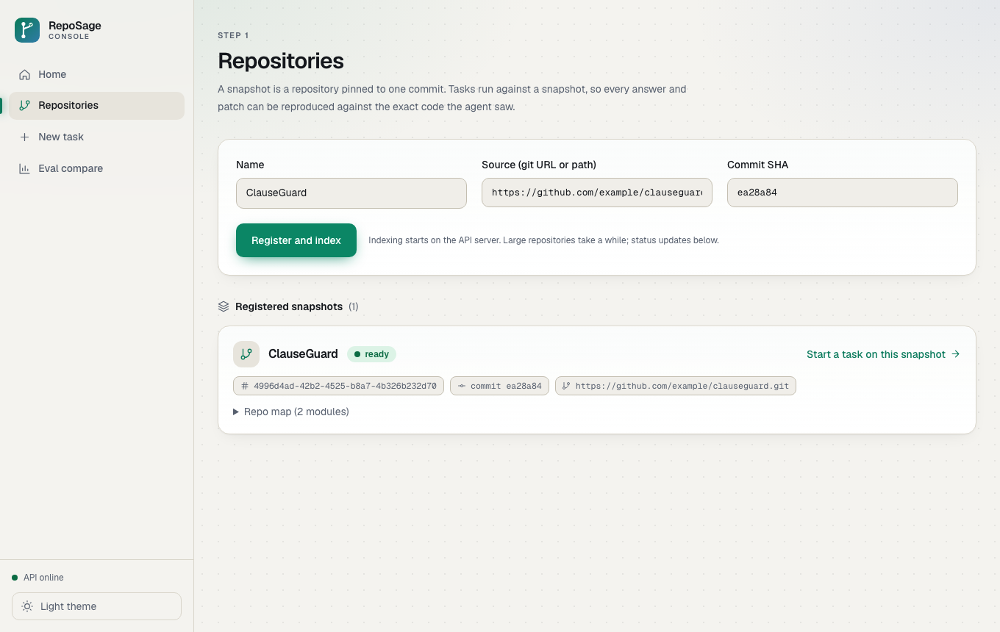
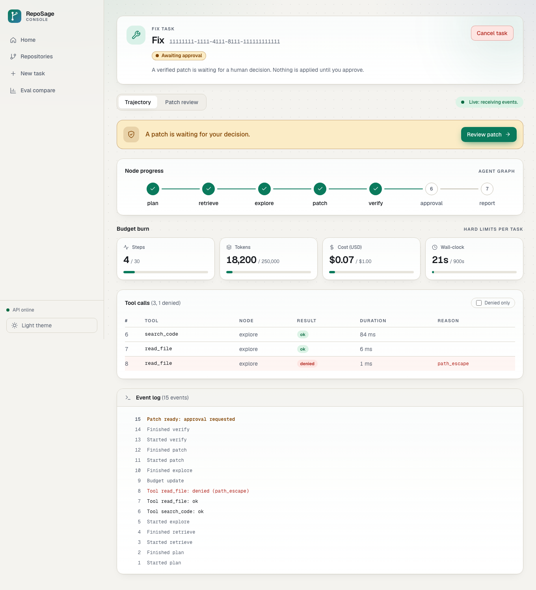
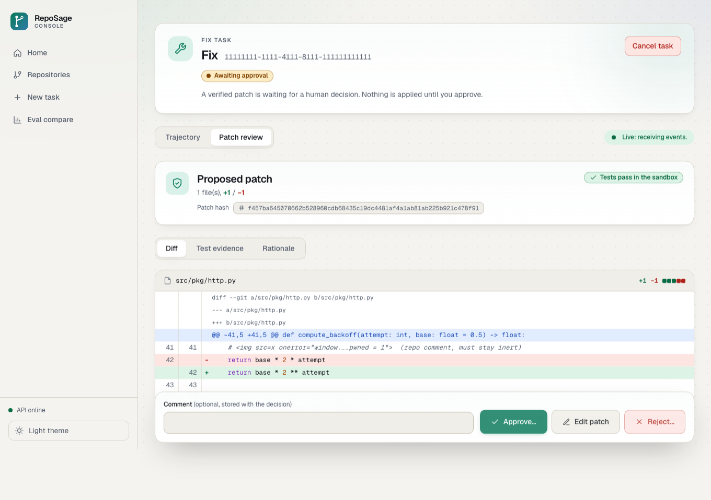
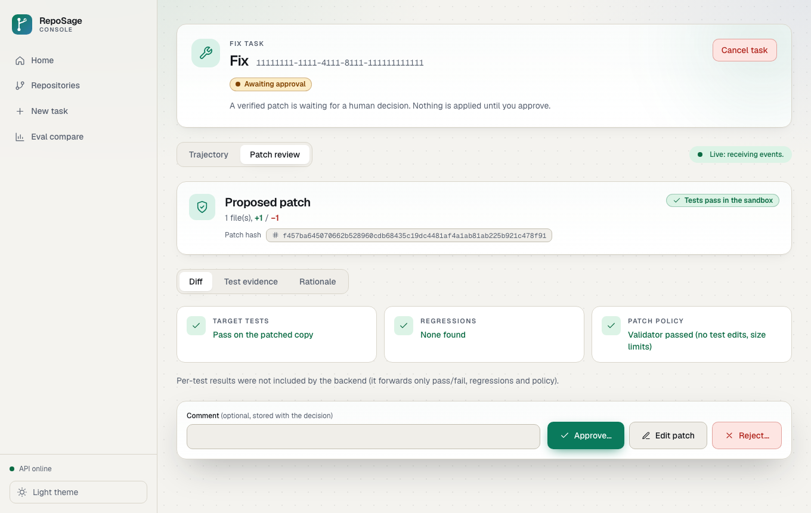
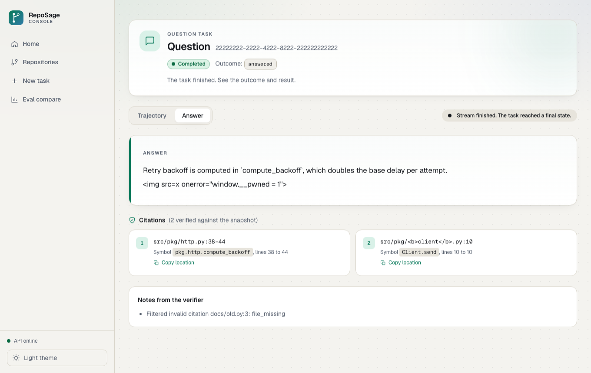
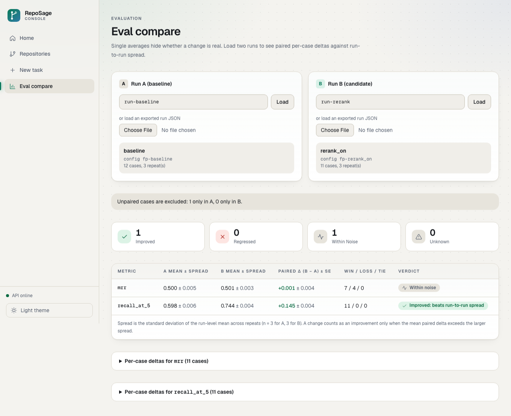

# RepoSage: an agentic codebase assistant that has to prove its work

RepoSage answers questions about a code repository and fixes failing tests. Its design rule is that **a model's claim is never accepted on trust**:

- **QA mode.** Every answer carries citations (file, line range, symbol). A deterministic verifier checks each citation against the real files, and citations that don't resolve are dropped.
- **Fix mode.** The agent proposes a minimal diff. The diff is validated by policy code, then **run against the tests in a network-less sandbox**. Nothing touches the working copy until a human approves that exact patch hash.

It is a full-stack system: FastAPI + Celery + Postgres/pgvector backend, a LangGraph agent, a sandbox runner, an evaluation harness, and a Vue 3 + TypeScript review console.

> **Not deployed, on purpose.** The sandbox executes model-written code in Docker, so it needs a dedicated host I'm not running for a portfolio project. This README is therefore the evidence: screenshots of the real UI, test counts you can reproduce, a [60-second local demo](#see-it-running-in-60-seconds-no-backend-needed), and a [candid status table](#what-works-and-what-doesnt) that says what is and isn't wired end to end.

## The console

The reviewer-facing UI (Vue 3, strict TypeScript). Screenshots come from the scripted mock server in `frontend/mock/`, which enforces the real API's rules; regenerate them with `bun run screenshots`.

| | |
|---|---|
|  |  |
| **Repositories.** Register a repo at a pinned commit and watch indexing go queued, ingesting, ready. | **Trajectory.** Live SSE view: node progress, every tool call (denied ones highlighted with the policy reason), budget burn against steps, tokens, USD and seconds. |
|  |  |
| **Approval review.** Diff plus the patch hash. Approve, edit or reject always sends the pending `patch_sha256`. | **Test evidence.** Target tests, regressions and policy results from the sandbox run. |
|  |  |
| **QA answer.** Citations with path, line range and symbol; a distinct state when nothing was found. | **Eval compare.** Paired per-case deltas with run-to-run spread, not just averages. |

## Why this is interesting engineering

| Problem | What I did |
|---|---|
| Models invent file paths and line numbers | Citations are verified against the snapshot by code (`agent/citations.py`); unverifiable ones are dropped and noted, not shown. |
| Models are untrusted, and so is repo text (prompt injection) | One policy chokepoint (`tools/policy.py`) enforces a per-node tool allowlist, schema validation, path containment (symlink-safe), a pytest-selector regex and output secret redaction. These are code, not prompt instructions. `apply_patch` is not in the model's tool list at all. |
| "Tests pass" can be gamed by editing the tests | The patch validator rejects any change to test files or runner config (`conftest.py`, `pytest.ini`, ...). The sandbox also mounts test trees read-only, as a second layer. |
| Running generated code is dangerous | Sandbox containers: `--network none`, read-only root, non-root user, all capabilities dropped, memory/CPU/PID/time limits. Infra errors are classified separately from test failures so the agent can't "fix" an OOM. |
| Passing tests don't prove a patch is right | Mandatory human-in-the-loop gate. The API stores which diff hash was approved and returns **409** if the patch changed since the reviewer looked. |
| Code search is not text search | Symbol-level AST chunking, identifier expansion (`parse_retry_header` is also indexed as "parse retry header"), vector + full-text + trigram retrieval fused with Reciprocal Rank Fusion in one SQL query, optional cross-encoder rerank. |
| Agents loop and burn money | Hard budgets (steps, tokens, USD, wall clock) checked between nodes, a loop detector over normalised tool-call fingerprints, bounded repair attempts, and a graceful partial report on breach. |
| "It seems better" is not evidence | An eval harness with a synthetic bug injector (mutate source, require an existing test to fail), retrieval/QA/fix/trajectory metrics, pass@k, and paired comparison that only calls a change an improvement if it beats run-to-run spread. |

## Architecture

```text
START -> Plan -> Retrieve -> Explore <-----+
                    |          |  |        |
                    |          |  +--loop--+   (bounded: budget + loop detector)
                    |          v
                    |     [QA?]--yes--> Report -> END
                    |          |
                    |          no (fix)
                    |          v
                    |        Patch -> Verify --fail(bounded)--> Patch
                    |                    |
                    |                  pass
                    |                    v
                    |                Approval (interrupt)
                    |               /     |      \
                    |         approve   edit    reject
                    |             |       |        |
                    |        apply_patch  Verify   Report
                    +-----------> Report -> END
Any node --budget breach / fatal error--> Report (partial) -> END
```

```text
Vue console --REST + SSE--> FastAPI --enqueue--> Celery worker --> LangGraph agent
                              |                       |               |-> LLM gateway (retry, fallback, cost ledger)
                              |                       |               |-> Retrieval (pgvector + FTS + trigram, RRF)
                              |                       |               |-> Policy chokepoint -> MCP tool server
                              v                       v               '-> Sandbox runner (Docker, no network)
                          PostgreSQL <-- events, patches, approvals, usage ledger, leases
```

Key design choices:
- **Explicit state machine, not a free-form loop.** Every transition is inspectable, budgeted and (by design) resumable.
- **State in Postgres, stateless workers.** Task status transitions are single atomic `UPDATE ... WHERE status = ANY(...)` statements; workers hold per-task leases.
- **Durable ordered event log.** Graph nodes emit events; a recorder persists them in order, and the API streams them as SSE with `Last-Event-ID` resume.
- **Provider-agnostic LLM layer.** Retry with full-jitter backoff, fallback chain, token-bucket limiter, per-call cost accounting.

Source layout (`src/reposage/`, about 7.6k lines of Python): `api/` routes and schemas, `agent/` graph, nodes, budget, loops, patch validator, citations; `ingest/` and `retrieval/`; `llm/`; `tools/` (policy, MCP server); `sandbox/`; `workers/` (Celery, leases, event recorder); `evals/`; `observability/`.

## Evidence you can reproduce

| What | Result | Command |
|---|---|---|
| Backend tests (unit, integration, adversarial, chaos) | 43 passing | `uv run pytest tests/` |
| Frontend unit, component, MSW flow and security tests | 157 passing | `cd frontend && bun run test` |
| Frontend end-to-end (Playwright, real Chromium) | 17 passing: golden path, keyboard-only approval, 409 stale patch, SSE drop and resume, axe in light and dark | `cd frontend && bun run test:e2e` |
| Type safety and lint | `vue-tsc --noEmit` and ESLint clean | `bun run typecheck && bun run lint` |
| Performance and accessibility budgets | Lighthouse CI budgets enforced (accessibility 1.00, performance at least 0.90, JS at most 200 KB); when last measured: performance 0.96 to 1.00, JS 55 to 116 KB | `cd frontend && bun run lhci` |

Notable tests: the backend adversarial suite (prompt injection, path traversal, test tampering); frontend tests that **fail if the UI ever approves without the current `patch_sha256`** or renders untrusted text as HTML. I mutation-checked both by injecting a `v-html` and by sending a wrong hash, and the tests failed as intended.

## See it running in 60 seconds (no backend needed)

The mock server replays a scripted fix run (nodes, tool calls including a denied one, budget updates, an approval request) and enforces the real approval rules.

```bash
cd frontend
bun install
bun run mock                                         # terminal 1: scripted API on :8788
API_PROXY=http://127.0.0.1:8788 bun run dev          # terminal 2, open http://localhost:5173
```

Then open `/tasks/11111111-1111-4111-8111-111111111111`, follow the link to review the patch and approve it. Try `/evals/compare?a=run-baseline&b=run-rerank` for the eval view.

## Run the real backend

```bash
uv sync
uv run pytest -v tests/                              # runs without Docker
uv run uvicorn reposage.api.main:app --port 8000     # API (needs Postgres with pgvector, Redis)
uv run celery -A reposage.workers.celery_app worker -P threads -c 4 -l info
uv run uvicorn reposage.sandbox.runner_service:app --port 9000   # needs a Docker daemon
cd frontend && bun run dev                           # console, proxies /v1 to :8000
```

`docker-compose.yml` defines the services but the repo has no Dockerfile yet, so `docker compose build` does not work as committed. See below.

## What works and what doesn't

Honest status, because "it's in the diagram" is not the same as "it runs".

| Area | Status |
|---|---|
| REST API: register/list repos, snapshot status, create task, status, SSE events, approval (hash-bound, 409 on stale), cancel | Built and tested |
| Ingestion, hybrid retrieval, RRF fusion, query rewrite, rerank interface | Built; covered by integration tests |
| Policy engine, patch validator, citation verifier, budget manager, loop detector, secret redaction | Built; unit and adversarial tests |
| Agent graph (plan, retrieve, explore, patch, verify, approval, report) | Built; integration tests run it against a scripted LLM |
| Durable event log and SSE with `Last-Event-ID` | Built and tested |
| Review console (4 screens plus repos, new task, cancel, health) | Built and tested; developed against the OpenAPI schema and a contract-faithful mock |
| Eval harness: bug injector, metrics, runner, CLI | Built; the `compare` CLI prints placeholder numbers and there is no eval API yet, so the console's eval view reads exports |
| LangGraph checkpointer (Postgres) for crash-resume and approval pause/resume | **Not wired in the worker yet.** The graph is built without one, so the approval interrupt and crash-resume are designed but not working end to end |
| Circuit breaker | Implemented, but the worker doesn't pass breakers to the LLM client yet |
| Docker images and a running compose stack | **Missing Dockerfile**; the full stack has not been run end to end |
| `tool_call` / `llm_call` / `budget` live events | In the design and supported by the console; not emitted by the worker yet |
| Auth | Single shared API key; no submitter/approver roles |

The console's `frontend/docs/BACKEND_CONTRACT.md` records the full code-vs-design discrepancy list found while integrating (14 items at the time of writing; some have since been fixed). I'd rather ship that list than hide it.

## What I'd do next

1. Wire `AsyncPostgresSaver` into the worker then cover crash-resume and approval-resume with integration tests against a real Postgres.
2. Add the Dockerfile, bring up the compose stack, and run the Playwright golden path against it (the spec exists and skips with a reason when no stack is up).
3. Emit `tool_call` and `budget` events from the policy layer and budget manager.
4. Add eval endpoints so the compare view reads real runs, and publish a baseline-vs-rerank ablation table.
5. Move the sandbox to its own host (or gVisor/Firecracker) before pointing it at untrusted repositories.

## Tech stack

Python 3.12, FastAPI, SQLAlchemy (async), Alembic, PostgreSQL + pgvector + pg_trgm, Redis, Celery, LangGraph, MCP, Docker SDK, sentence-transformers, Prometheus, pytest, uv. Frontend: Vue 3, TypeScript (strict), Vite, Bun, Pinia, TanStack Query, Tailwind, Reka UI, Zod, openapi-typescript + openapi-fetch, Vitest, MSW, Playwright, axe-core, Lighthouse CI.

## Layout

```text
reposage/
├── src/reposage/        # backend (api, agent, retrieval, llm, tools, sandbox, workers, evals, observability)
├── tests/               # unit, integration, adversarial, chaos
├── prompts/             # versioned prompts, hashed per call
├── migrations/          # Alembic
├── frontend/            # Vue console, mock API, e2e, docs/BACKEND_CONTRACT.md
├── docker-compose.yml   # service definitions (see status above)
├── gate.yaml            # CI quality-gate thresholds
└── Makefile
```

## Security notes

- The model never receives `apply_patch`; writes happen only after an approval record exists for the exact diff hash.
- Repository text, tool output and model output are treated as untrusted everywhere, including in the UI (no `v-html`, no markdown renderer; enforced by lint and by tests).
- Prompts, traces and tool outputs are scanned for high-entropy tokens and key headers and redacted before persistence.
- The sandbox runner is a separate service so general workers never hold the Docker socket. For anything beyond a demo, run it on a dedicated host.
